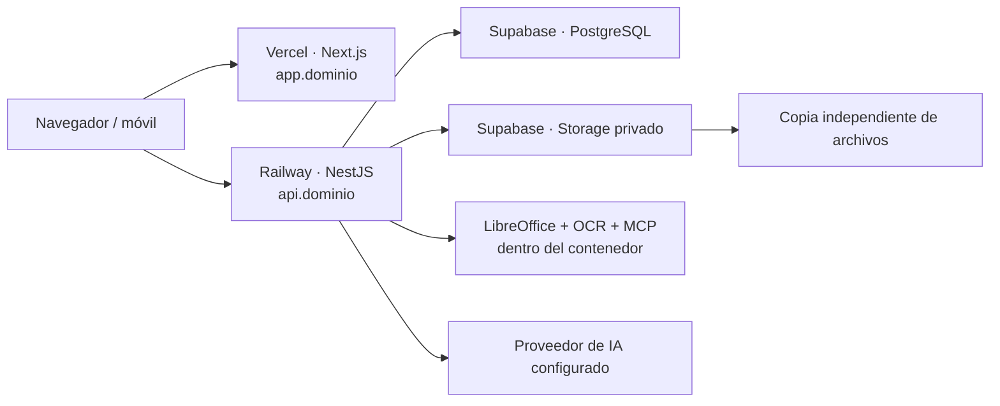

# Referencia futura: despliegue de Tabelio con servicios de pago

Fecha: 10 de noviembre de 2026. Este documento conserva la propuesta inicial de un piloto con servicios de pago. El alcance actual es una demo de pruebas para dos usuarios, descrita en `PLAN_DESPLIEGUE_VERCEL_SUPABASE.md`; esta referencia no exige contratar esos servicios para la demo.

## Recomendación

Usar **Vercel para la web, Supabase para PostgreSQL y Storage, y Railway para la API NestJS en Docker**. Render es una alternativa para ese contenedor.

Vercel y Supabase son una buena base, pero el backend actual necesita un lugar donde ejecutar LibreOffice, Poppler, Tesseract y el servidor MCP. Mantenerlo en un contenedor aprovecha la implementación existente y evita convertir el piloto en una reescritura.

| Componente | Servicio | Configuración inicial |
| --- | --- | --- |
| Web Next.js | Vercel Pro | `app.<dominio>`; despliegue de `apps/web` |
| API NestJS, PDF, OCR y asistente | Railway | `api.<dominio>`; una réplica siempre activa; capacidad inicial de 2 GB RAM, por validar con cargas |
| PostgreSQL | Supabase Pro | Proyecto exclusivo del piloto; acceso desde backend y migraciones |
| Documentos | Supabase Storage | Bucket privado; adaptador S3 actual |
| Copias de archivos | Destino independiente | Copia con retención; no propagar borrados del origen |

Dimensionamiento provisional: 2–10 usuarios internos y una muestra inicial de 10–20 expedientes. Estas cifras sirven para preparar y probar el piloto; no son una estimación de uso confirmada por el despacho.

El navegador llama directamente a la API para operaciones y archivos. No recibe credenciales de PostgreSQL, S3 ni del proveedor de IA.

## Por qué encaja con la aplicación

- `apps/web` ya usa Next.js y un endpoint de API configurable.
- `apps/api` es un servidor NestJS separado. El `Dockerfile` ya incluye las herramientas nativas, plantillas DOCX y ejecución sin privilegios.
- Prisma ya utiliza PostgreSQL; no se requiere reemplazar el modelo de datos.
- `ObjectStorageService` ya soporta S3 con endpoint, región y credenciales configurables.
- La API ya comprueba organización, membresía, rol y versión de sesión. Se conserva esa autenticación durante el piloto.
- Existen migraciones, controles del piloto, health checks y pruebas de aislamiento que se pueden reutilizar.

La integración real con los proveedores todavía debe probarse. Esta revisión no equivale a un despliegue ni a una validación de credenciales.

## Ajustes necesarios antes de publicar

### 1. Preparar código y builds

- Crear un repositorio Git privado con el código necesario. Esta carpeta no tiene actualmente un repositorio Git detectable.
- Ampliar las exclusiones: `.env*` salvo ejemplos, certificados, respaldos, almacenamiento, temporales, originales jurídicos y exportaciones con datos personales. El `.gitignore` actual sólo excluye algunos nombres concretos de archivos de entorno.
- Revisar el contenido que recibe `COPY . .` en Docker; usar un contexto de construcción que no incluya el corpus documental ni datos del despacho.
- Separar el build de web del de API. Vercel debe construir `apps/web`, no ejecutar el `npm run build` raíz que también compila backend y Prisma.
- Preparar un Dockerfile de backend o una imagen etiquetada que termine en el target `api`. El último target del Dockerfile actual es `web`; no basta con que Railway detecte el archivo automáticamente.
- Mantener un job separado basado en el target `migrate`. La imagen final de API elimina dependencias de desarrollo y no garantiza la presencia del CLI de Prisma.
- Fijar versiones compatibles de Node y npm en local, CI y proveedores; el contenedor actual usa Node 24.

### 2. Resolver dominios, sesiones y rutas

- Configurar HTTPS en `app.<dominio>` y `api.<dominio>`, bajo el mismo dominio registrable. Las cookies actuales usan `HttpOnly`, `SameSite=Lax` y son exclusivas del host de la API.
- Configurar `NEXT_PUBLIC_API_URL=https://api.<dominio>/api`, `WEB_ORIGIN=https://app.<dominio>` y `COOKIE_SECURE=true`.
- Mantener CORS con orígenes exactos y credenciales. Comprobar la protección de peticiones de escritura frente a orígenes no autorizados; CORS por sí solo no sustituye protección CSRF.
- Probar login, recarga, descarga y logout en navegadores de escritorio y móvil. No combinar `*.vercel.app` con `*.railway.app` como configuración final: son sitios distintos y la política de cookies actual no sirve para esas peticiones entre sitios.
- Adaptar **Llévalo en tu móvil**: hoy genera direcciones de red local y la ruta Next `/api/local-access` espera recibir una cookie que, con API separada, pertenecerá a otro host. En nube debe generar el enlace público HTTPS sin depender de esa ruta local ni pedir certificados locales.
- El conector de presupuesto IBM y su extensión sólo autorizan `http://localhost:3000`. Si se necesita en el piloto, autorizar expresamente el dominio final y probar el intercambio de mensajes; si queda fuera, indicar su indisponibilidad en la interfaz.
- Mantener un único `WEB_ORIGIN` canónico en el piloto: invitaciones de portal y recuperación construyen sus enlaces a partir de esa variable. Agregar varios orígenes requiere separar la URL pública de la lista CORS.

Las cargas de hasta 20 MiB por archivo deben ir directamente a la API. El backend acepta lotes de diez archivos y el asistente hasta tres adjuntos. Vercel documenta un límite de 4.5 MB para cuerpos de Vercel Functions; ese límite no debe extrapolarse automáticamente a todos los rewrites externos. El diseño propuesto evita depender de un intermediario de Vercel para esas cargas.

### 3. Integrar PostgreSQL y Storage

- Crear Supabase en una región cercana a la API y a los usuarios; medir latencia antes de fijar la región definitiva.
- Para Prisma en contenedor persistente, comenzar con conexión directa si hay conectividad compatible, o Supavisor en **modo sesión**. Verificar TLS y acotar el pool de conexiones.
- El endpoint directo de Supabase puede requerir IPv6; el pool de sesión es una opción cuando el proveedor sólo dispone de IPv4. Copiar las cadenas del panel, sin asumir hosts o puertos por similitud.
- Para migraciones, usar conexión directa o pool de sesión compatible, con permisos de DDL. Inyectar una `DATABASE_URL` propia al job: no hace falta introducir `DIRECT_URL` para esta arquitectura. No usar el pool transaccional para migraciones.
- Separar credenciales de migración y ejecución; limitar los permisos del rol de ejecución a lo que usa la aplicación.
- Desactivar Supabase Data API si no se utilizará. Las tablas Prisma actuales están en `public` y no tienen políticas RLS. Usar Supabase no añade por sí mismo el aislamiento que hoy implementa NestJS.
- Crear el bucket privado y generar credenciales del protocolo S3. Configurar `S3_FORCE_PATH_STYLE=true`, endpoint y región copiados del panel.
- Verificar carga, lectura, borrado, metadatos y nombres con acentos. Las credenciales S3 del proyecto omiten RLS y sólo deben existir en el backend; el bucket privado no sustituye los permisos de la API.
- Conservar la autorización por organización y las llaves de objeto actuales. No habilitar acceso directo desde el navegador a la base o al bucket en esta fase.

### 4. Configurar la API para el piloto

- Una réplica y suspensión automática deshabilitada. Confirmaciones, adjuntos temporales y sesiones MCP están en memoria; se pierden al reiniciar y no se comparten entre réplicas.
- Conservar `/mcp` para acceso interno por loopback, `MCP_LOCAL_ONLY=true` y URLs coherentes con el puerto real. Verificar que una petición externa no pueda acceder a MCP a través del proxy del proveedor.
- Adaptar el arranque al puerto de la plataforma. Hoy el servidor lee `API_PORT`, no `PORT`; elegir un puerto fijo configurado en Railway o hacer que el servidor acepte `PORT` y actualizar también las URLs MCP.
- Usar `/api/health/ready` para la comprobación del despliegue y `/api/health/live` para disponibilidad del proceso.
- Probar tiempos máximos con conversiones, OCR y asistente. Evitar timeouts del proxy inferiores a los de la operación de backend.
- Medir memoria con archivos grandes y lotes, porque se reciben en RAM. Acotar concurrencia y ajustar recursos antes de admitir la carga máxima anunciada.
- Configurar JWT aleatorio y secretos independientes del entorno local. La clave de IA sólo pertenece al backend.
- Mantener inicialmente `PASSWORD_RECOVERY_DRIVER=disabled` y retirar la expectativa de envío de correo en la interfaz. Preparar un procedimiento administrativo seguro de recuperación durante el piloto. El proveedor actual no envía correos en producción; cambiar una variable a `smtp` no lo implementa.

## Secuencia de integración

Estimación de trabajo: **4–7 días hábiles**, con cuentas, dominio y accesos disponibles. Añadir una semana de observación del piloto. Es una estimación, pendiente del primer build y de la prueba S3 real.

| Fase | Trabajo | Entregable y criterio de salida |
| --- | --- | --- |
| 1. Preparación | Repositorio privado, exclusiones, builds separados, puerto y configuración | Web y API construyen de forma independiente sin datos privados en las imágenes |
| 2. Infraestructura | Supabase, Railway, Vercel, DNS, TLS, secretos y límites de gasto | API conecta a PostgreSQL y Storage; `/health/ready` responde correctamente |
| 3. Integración web | Cookies, CORS, cargas directas, QR público y decisión sobre conector IBM | Recorrido autenticado completo en escritorio y móvil |
| 4. Datos y restauración | Bootstrap limpio o migración controlada; copias de DB y archivos | Conteos y checksums conciliados; restauración comprobada en destino aislado |
| 5. Validación | Pruebas existentes y recorrido real contra los proveedores | Sin fallas bloqueantes; evidencia de permisos, archivos, contratos y aislamiento |
| 6. Apertura del piloto | Cohorte, capacitación, muestra, monitoreo y operación paralela | Usuarios del despacho operan una muestra y registran incidencias |

Para validar antes de abrir, usar un entorno temporal con datos sintéticos y secretos separados. Las previews de Vercel no deben apuntar a los datos reales del piloto. Un segundo proyecto Supabase puede generar costo adicional; puede mantenerse sólo durante la validación.

## Tratamiento de los datos existentes

Elegir una de estas rutas al preparar la muestra:

1. **Inicio limpio:** aplicar migraciones a una base vacía y crear organización, administrador y catálogos necesarios con un bootstrap específico. No ejecutar el seed demo sin revisar: incluye usuarios y datos de demostración.
2. **Conservar datos seleccionados:** preparar una copia aislada, depurar el alcance del piloto y congelar escrituras durante el corte. Exportar el esquema y los datos de aplicación, preservando IDs, historial Prisma y relaciones. Copiar los binarios conservando llaves y checksums. No reemplazar los esquemas administrados de Supabase (`auth`, `storage`, etc.).

En ambas rutas, verificar el campo de bucket/proveedor que guarden los registros, descargas históricas, documentos derivados y referencias de la biblioteca jurídica. El corpus de la biblioteca no se incluye automáticamente en la imagen: migrar sus objetos o usar el importador documentado con fuentes disponibles en un job controlado.

## Entrega continua y reversión

1. Ejecutar instalación reproducible, `npm test`, `npm run lint` y los builds correspondientes en CI, con base de pruebas cuando se requiera.
2. Preparar una copia verificable antes de cambios de datos.
3. Ejecutar `npm run db:deploy` una sola vez por release desde el job de migración, usando credenciales del destino.
4. Desplegar API y esperar readiness.
5. Publicar la web compatible y ejecutar el smoke del entorno.

Coordinar estos pasos; los despliegues automáticos independientes de Vercel y Railway no garantizan este orden. Mantener migraciones compatibles con la versión anterior y cambios destructivos en releases posteriores.

Para revertir, volver a imágenes y deployment anteriores si el esquema sigue siendo compatible. Una migración Prisma no tiene reversión automática: cualquier restauración de datos requiere una decisión explícita, un destino nuevo y conciliación de lo ocurrido después del respaldo.

Los scripts `pilot:deploy`, `pilot:backup` y `pilot:verify-backup` están acoplados al PostgreSQL de Compose. Adaptarlos para servicios remotos; no ejecutarlos sin cambios como si ya administraran Supabase.

## Respaldo y operación

- Supabase Pro incluye respaldo diario de PostgreSQL con siete días de retención según la tarifa consultada. Mantener además una exportación controlada fuera del proyecto.
- Respaldar **los archivos de Storage por separado**. El respaldo de base conserva metadatos, no los binarios. Supabase Storage no ofrece versionado S3; un borrado no se recupera por ese mecanismo.
- Crear diariamente una copia de objetos con manifiesto y retención, en un destino independiente con historial de versiones o instantáneas. Un espejo que replica borrados no es suficiente.
- Comprobar que el punto de restauración contenga todos los objetos referenciados por la copia de DB. Para el piloto puede coordinarse una breve ventana de mantenimiento para una copia coherente.
- Objetivos iniciales propuestos: pérdida máxima de 24 horas de información y recuperación en cuatro horas. Confirmarlos con un ensayo; no son garantías del servicio contratado.
- Alertas por indisponibilidad, errores 5xx, fallas de respaldo y gasto. Logs con identificador de petición, sin tokens, credenciales ni contenido de identificaciones.
- Realizar despliegues fuera de sesiones activas y comunicar que se descartan los adjuntos y confirmaciones aún pendientes del asistente.

## Criterios para abrir a usuarios

- [ ] Login, logout, caducidad e invalidación de sesión funcionan con HTTPS en escritorio y móvil.
- [ ] Roles correctos y prueba de aislamiento con dos organizaciones de prueba.
- [ ] Ninguna consulta anónima a las tablas o documentos; MCP inaccesible desde Internet.
- [ ] Carga y descarga de archivos de 20 MiB, lotes y adjuntos sin errores de proxy ni falta de memoria; si no se soporta el máximo, ajustar antes la capacidad o el límite anunciado.
- [ ] Generación DOCX, conversión PDF, vista previa y OCR con herramientas reales del contenedor.
- [ ] Asistente con proveedor configurado, consumo registrado y confirmación de escrituras.
- [ ] Portal externo con enlaces del dominio correcto y aceptación auditada de documentos.
- [ ] QR público funcionando; conector IBM probado o fuera del alcance indicado.
- [ ] Administrador propio y recuperación asistida documentada; ninguna credencial demo habilitada.
- [ ] Restauración completa de DB y objetos comprobada; readiness y monitoreo activos.
- [ ] Sin incidencias altas o críticas abiertas; al menos dos participantes capacitados, conforme al runbook existente.

Usar el recorrido operativo `10 → 25 → 50 → 100` del módulo de piloto para ampliar la muestra/cohorte y registrar evidencia. Esos porcentajes operativos no configuran automáticamente reparto de tráfico en Vercel o Railway.

## Presupuesto y alternativas

Referencias consultadas el 10 de noviembre de 2026; importes en USD, antes de impuestos, sujetos a consumo y cambios del proveedor.

| Servicio | Referencia para el piloto |
| --- | --- |
| Vercel Pro | Desde USD 20/mes; confirmar asientos y consumo |
| Supabase Pro | Desde USD 25/mes para el primer proyecto con compute inicial incluido en la estimación publicada |
| Railway API | Reservar USD 10–30/mes como estimación de consumo; no es una tarifa fija. Hobby publica mínimo de USD 5 y Pro de USD 20 |
| Total base estimado | USD 55–75/mes |

Añadir dominio, copia independiente de archivos, IA, correo si se integra, excedentes y cualquier entorno adicional. Para presupuestar con margen inicial, reservar **USD 60–90/mes más IA** y ajustar tras medir el uso. No basar el piloto de negocio en Vercel Hobby: su documentación limita ese plan al uso personal no comercial. Supabase Free puede pausarse tras una semana sin actividad.

Alternativas:

- **Railway para web y API + Supabase para datos:** reduce de tres a dos los proveedores principales. Es una buena opción si se prioriza una sola operación de contenedores; requiere operar también el servidor Next.js y comparar el costo real.
- **Render para API + Vercel y Supabase:** arquitectura equivalente; elegir por región, recursos, tiempos y experiencia del equipo.
- **VPS con Docker Compose:** reutiliza el despliegue existente, pero el equipo se hace cargo de parches, disponibilidad, base y restauraciones. No es la primera opción para este piloto pequeño.
- **Todo en Vercel y Supabase Edge Functions:** exigiría rediseñar procesamiento nativo, MCP y estado temporal. No aporta una ventaja suficiente para el primer despliegue.

Después del piloto: correo real de recuperación, programación de recordatorios, persistencia del estado del asistente y procesamiento en cola si la demanda lo requiere. Antes de varias réplicas hay que resolver el estado en memoria; no basta con activar autoscaling.

## Fuentes y documentación relacionada

- [Precios Vercel](https://vercel.com/pricing), [condiciones Hobby](https://vercel.com/docs/plans/hobby) y [límites de Functions](https://vercel.com/docs/functions/limitations).
- [Precios Supabase](https://supabase.com/pricing), [Prisma](https://supabase.com/docs/guides/database/prisma) y [respaldos](https://supabase.com/docs/guides/platform/backups).
- [Autenticación S3 de Supabase](https://supabase.com/docs/guides/storage/s3/authentication) y [compatibilidad, incluido versionado no soportado](https://supabase.com/docs/guides/storage/s3/compatibility).
- [Precios Railway](https://railway.com/pricing), [Dockerfiles](https://docs.railway.com/guides/dockerfiles) y [configuración de despliegue](https://docs.railway.com/reference/config-as-code).
- Documentación local: `docs/PILOT_RUNBOOK.md`, `docs/BIBLIOTECA_JURIDICA.md`, `docs/MCP.md` y `docs/ASSISTANT.md`.
